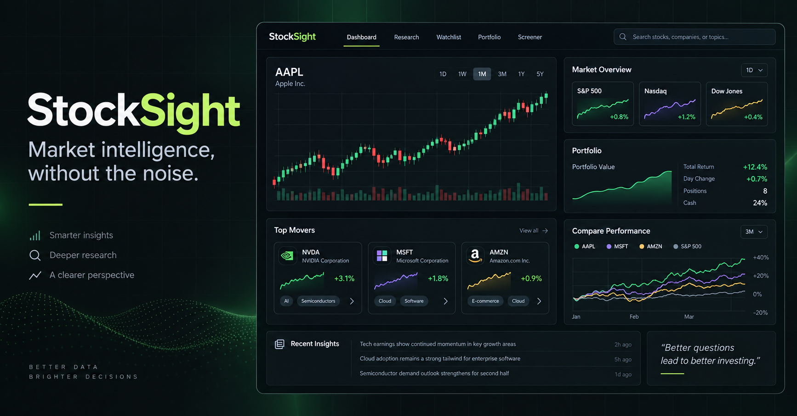

# StockSight

StockSight is a responsive market-research and portfolio workspace built to make price action, technical signals, holdings, and long-term scenarios understandable in one place.



## Highlights

- Live Finnhub quotes with Yahoo Finance daily history and a clearly labelled deterministic demo fallback
- A Key Stats table built only from real inputs (price, market cap, volume, 52-week range); fields without a data source show "—"
- Candlestick charts with SMA-50 and SMA-200 overlays and multiple time ranges
- Explainable RSI/SMA/momentum recommendations with visible scoring and signal strength
- Multiple portfolios with fractional shares, average cost, cash, gain/loss, and sector allocation
- Local-first persistence for guests and user-scoped Supabase sync for authenticated users
- Side-by-side comparison of up to three stocks, including normalized return, CAGR, volatility, and drawdown
- Company news, portfolio tables, performance periods, and a contribution-based wealth forecaster
- Keyboard-friendly search, responsive layouts, reduced-motion support, empty states, and explicit live/demo labels

## Architecture

```text
React + TypeScript UI
        │
        ├── SWR quote orchestration (60 s refresh)
        │     ├── Finnhub ── /quote, /stock/profile2, news (called from the browser)
        │     └── /api/yahoo-finance/v8/finance/chart/<TICKER>
        │           ├── production: vercel.json rewrite → api/yahoo-finance.js → Yahoo Finance
        │           └── local dev:  Vite proxy → Yahoo Finance
        ├── analytics ── SMA / RSI / CAGR / volatility / drawdown
        └── portfolio state
              ├── IndexedDB (all visitors, local-first)
              └── Supabase (authenticated users only, RLS protected)
```

## Data sources

| Data | Source | Notes |
| --- | --- | --- |
| Last price, previous close | Finnhub `/quote` | Refreshed every 60 seconds. `/quote` has no volume field. |
| Sector, shares outstanding | Finnhub `/stock/profile2` | Fetched once per ticker per session. Market cap = last price × shares outstanding. |
| Daily candles (charts, volume, 52-week range, signals) | Yahoo Finance chart API via `/api/yahoo-finance` | Cached in memory for 6 hours. At least 200 sessions are required. |
| Company and market news | Finnhub `/company-news`, `/news` | |

- **No history from Finnhub on the free tier.** The app still tries Finnhub `/stock/candle` first, but free keys get `403`. After the first `401`/`403` it stops asking for the rest of the session and uses Yahoo Finance only.
- **The Yahoo proxy.** Browsers can't call Yahoo directly (CORS), so requests go to `/api/yahoo-finance/...`:
  - In production, the rewrite in `vercel.json` sends every such path to the single function `api/yahoo-finance.js`.
  - That function only proxies `/v8/finance/chart/<TICKER>`, tries `query1` and then `query2`, and returns JSON errors such as `{ "error": "Yahoo Finance is rate-limiting requests (HTTP 429)" }`.
  - With `npm run dev`, Vite's dev-server proxy forwards to Yahoo instead. The function itself only runs on Vercel deployments; its behaviour is covered by `tests/yahooProxy.test.ts`.
- **When history is unavailable,** the quote is still shown. Charts show "Price history unavailable" with the reason, and technical signals show `UNAVAILABLE`.
- **When the Finnhub quote fails** (missing or invalid key, rate limit), the app falls back to a deterministic demo series that is labelled as demo data everywhere. Demo rows report nothing in Key Stats.
- **Not connected:** earnings estimates, P/E, dividends and price-to-book need a fundamentals feed that isn't wired in. Those Key Stats columns show "—".
- **The Finnhub key is public.** `VITE_` variables are compiled into the browser bundle, so anyone using the site can read `VITE_FINNHUB_API_KEY`. Use a free-tier key that is safe to expose.

The app keeps guest data on-device. Cloud reads and writes are attempted only when a verified Supabase user ID is present, and the included SQL policies restrict every row to its owner.

## Tech stack

React 18, TypeScript, Vite, Tailwind CSS, SWR, Lightweight Charts, Recharts, Supabase, Finnhub, and Yahoo Finance.

## Run locally

```bash
npm install
copy .env.example .env
npm run dev
```

The app runs at `http://localhost:4000`. Add the relevant keys to `.env`; never commit that file. A free [Finnhub](https://finnhub.io/register) key is enough. Yahoo Finance needs no key.

```env
VITE_FINNHUB_API_KEY=
VITE_SUPABASE_URL=
VITE_SUPABASE_ANON_KEY=
```

For cloud sync, run `supabase/portfolio_state.sql` in the Supabase SQL editor and enable email authentication. The app remains fully usable through IndexedDB when Supabase is not configured.

## Quality checks

```bash
npm run typecheck
npm test
npm run build
```

Before deploying, run Lighthouse against the production URL and test at 320px, 768px, 1440px, and an ultrawide viewport.

## Data transparency

- A green label means the current quote came from a live provider.
- An amber label means the displayed series is deterministic demonstration data.
- The Key Stats table shows only values computed from live data. Anything without a real source shows "—" instead of an estimate.
- If daily history can't be loaded, charts say so and give the reason instead of drawing an empty or simulated series.
- Technical signals require at least 200 real daily sessions; the app does not issue a recommendation from simulated history.
- Forecasts use historical CAGR as a scenario assumption, not a prediction.

## Deployment

Build with `npm run build` and deploy to Vercel (production branch: `master`). Set `VITE_FINNHUB_API_KEY`, `VITE_SUPABASE_URL` and `VITE_SUPABASE_ANON_KEY` in the Vercel project's environment variables. Because they are `VITE_` variables, they are read at build time, so redeploy after changing them.

`vercel.json` rewrites `/api/yahoo-finance/:path*` to the `api/yahoo-finance.js` function. Vercel only routes catch-all filenames like `[...path].js` for Next.js projects, so keep the single-file function and the rewrite together. If charts go blank, open `/api/yahoo-finance/v8/finance/chart/AAPL?range=1mo&interval=1d` on the deployment. It should return JSON (chart data or an `{ "error": ... }` message), never Vercel's 404 page. Failures are logged in the function's runtime logs with a `[yahoo-finance]` prefix.

After deployment, replace the relative Open Graph image path in `index.html` with the absolute production URL for the most reliable LinkedIn preview.

## Engineering decisions

- **Graceful degradation:** external data failures never make the dashboard unusable.
- **Honest analytics:** demo series and real market inputs are distinguished in the interface, and missing data is shown as missing rather than estimated.
- **Explainability:** recommendations expose both their indicators and scoring thresholds.
- **Privacy by default:** anonymous portfolio data stays local rather than using a shared backend record.

## Disclaimer

StockSight is an educational software project. It is not financial advice, and its estimates, signals, and forecasts should not be used as the sole basis for an investment decision.
