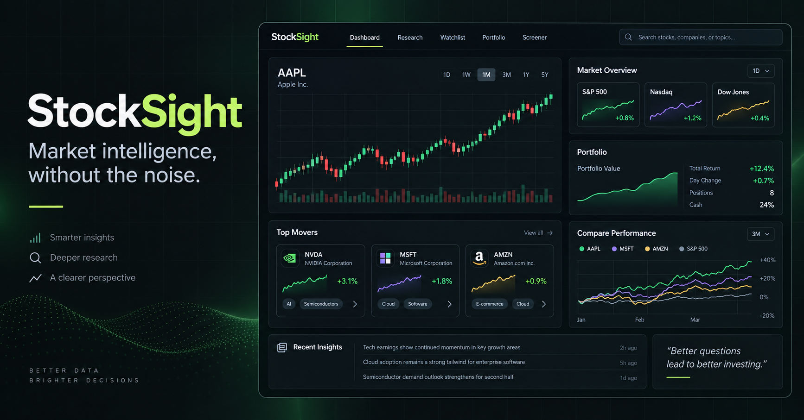

# StockSight

StockSight is a responsive market-research and portfolio workspace built to make price action, technical signals, holdings, and long-term scenarios understandable in one place.



## The app

Three views, switched from the header on tablets and up and from a bottom tab bar on phones:

- **Portfolio** — the active portfolio's value, today's change and total return; its holdings (or watchlist); and the selected stock in detail, with tabs for **Chart** (candlesticks with SMA-50 and SMA-200 and time ranges), **Analysis** (explainable RSI/SMA/momentum signals), **Forecast** (contribution-based time-to-target scenarios), **Compare** (up to three symbols: normalised return, CAGR, volatility, drawdown) and **News** (company stories). Below sit the portfolio tables: **Summary** (allocation, cash and positions, with a sector filter), **Holdings**, **Key Stats** and **Performance**. The portfolio menu switches between portfolios and creates, renames or deletes them.
- **Insights** — **Signals** (breadth, a searchable signal screener, today's leaders and the sector tape) and **Risk** (position concentration, volatility and a diversification check) for the symbols in the active portfolio.
- **News** — a general market news feed.

Other features:

- Live Finnhub quotes with Yahoo Finance daily history, and a clearly labelled deterministic demo fallback
- A Key Stats table built only from real inputs (price, market cap, volume, 52-week range); fields without a data source show "—"
- Multiple portfolios with fractional shares, average cost, cash, gain/loss and sector allocation
- Local-first persistence for guests and user-scoped Supabase sync for signed-in users
- Keyboard support throughout (Ctrl/Cmd+K for search, arrow keys in tabs and menus, focus-trapped dialogs), reduced-motion support, empty states and explicit live/demo labels

## Architecture

```text
React + TypeScript UI
        │
        ├── SWR quote orchestration (60 s refresh)
        │     ├── /api/finnhub/{quote, stock/profile2, company-news, news}
        │     │     ├── production and previews: vercel.json rewrite → api/finnhub.js → Finnhub (key added server-side)
        │     │     └── local dev and `npm run preview`: the same handler, run as Vite middleware
        │     └── /api/yahoo-finance/v8/finance/chart/<TICKER>
        │           ├── production and previews: vercel.json rewrite → api/yahoo-finance.js → Yahoo Finance
        │           └── local dev and `npm run preview`: Vite proxy → Yahoo Finance
        ├── analytics ── SMA / RSI / CAGR / volatility / drawdown
        └── portfolio state
              ├── IndexedDB (all visitors, local-first)
              └── Supabase (signed-in users only, RLS protected; client loaded on demand)
```

The heavier pieces load as separate chunks: the price chart (Lightweight Charts), the forecaster (Recharts), the comparison panel, and the Supabase client. The Supabase chunk is requested as the app starts; if it can't be fetched the app carries on as a guest on that device.

## Data sources

| Data | Source | Notes |
| --- | --- | --- |
| Last price, previous close | Finnhub `/quote` | Refreshed every 60 seconds. `/quote` has no volume field. |
| Sector, shares outstanding | Finnhub `/stock/profile2` | Fetched once per ticker per session. Market cap = last price × shares outstanding. |
| Daily candles (charts, volume, 52-week range, signals) | Yahoo Finance chart API via `/api/yahoo-finance` | Cached in memory for 6 hours. At least 200 sessions are required. |
| Company and market news | Finnhub `/company-news`, `/news` | |

- **History comes from Yahoo, not Finnhub.** Finnhub's `/stock/candle` answers `403 You don't have access to this resource` on the free plan, so the app doesn't call it.
- **The Yahoo proxy.** Browsers can't call Yahoo directly (CORS), so requests go to `/api/yahoo-finance/...`:
  - On Vercel, the rewrite in `vercel.json` sends every such path to the single function `api/yahoo-finance.js`.
  - That function only proxies `/v8/finance/chart/<TICKER>`, tries `query1` and then `query2`, and returns JSON errors such as `{ "error": "Yahoo Finance is rate-limiting requests (HTTP 429)" }`.
  - Locally, Vite's proxy forwards to Yahoo instead. The function itself only runs on Vercel; its behaviour is covered by `tests/yahooProxy.test.ts`.
- **When history is unavailable,** the quote is still shown. Charts show "Price history unavailable" with the reason, and technical signals show `UNAVAILABLE`.
- **When the Finnhub quote fails** (missing or invalid key, rate limit), the app falls back to a deterministic demo series that is labelled as demo data everywhere. Demo rows report nothing in Key Stats.
- **Not connected:** earnings estimates, P/E, dividends and price-to-book need a fundamentals feed that isn't wired in. Those Key Stats columns show "—".
- **The Finnhub key stays on the server.** The browser calls `/api/finnhub/<endpoint>`, and `api/finnhub.js` adds `FINNHUB_API_KEY` as the `X-Finnhub-Token` header. The key is not in the bundle, in any browser request, or in the upstream URL, and the function never logs it or echoes Finnhub's error bodies.
  - Only `quote`, `stock/profile2`, `company-news` and `news` are proxied, with validated parameters (`symbol`, `from`/`to` dates, news `category`). Anything else is a `400`, so the function can't be used as an open relay on the key.
  - Successful answers are cached by Vercel's CDN: quotes for 15 s, profiles for a day, news for 5 minutes.
  - With no key configured it answers `503 { "error": ..., "code": "FINNHUB_KEY_MISSING" }`, and the app shows its demo state, as it did without a key before. Upstream failures come back as `429`, `502` or `504` and are not cached.
  - `npm run check:bundle` (after `npm run build`) fails if `dist/` contains the key value, a `finnhub.io` URL, a `token=` parameter or the token header.

The app keeps guest data on-device. Cloud reads and writes are attempted only when a verified Supabase user ID is present, and the included SQL policies restrict every row to its owner.

## Design system

A dark, near-black interface with one coral accent. The tokens are CSS variables in the `@theme` block of `src/index.css`, so each one is also a Tailwind utility (`bg-surface`, `text-ink-muted`, `rounded-panel`, …). Code that can't use classes, such as the canvas charts, reads them at runtime through `src/theme/tokens.ts`.

| Group | Tokens |
| --- | --- |
| Surfaces | `canvas` `#09090b`, `surface` `#101012`, `raised` `#18181b` |
| Text | `ink` `#f0eeeb`, `ink-bright` `#ffffff`, `ink-muted` `#a4a4ad`, `ink-dim` `#8e8e97` (all at least 4.5:1 on every surface) |
| Lines | `line` (white at 9%), `line-strong` (white at 17%) |
| Accent | `accent` `#ff5c77` (coral; active markers, focus, small highlights), `accent-deep` `#cc0033` |
| Meaning | `gain` `#3dd68c`, `loss` `#ff6b57`, `warn` `#e9b44c` — always paired with a sign or icon, never colour alone |
| Charts | `violet` `#a59cf5` (second series: SMA-200, comparison lines) |
| Other | `scrim` (dialog backdrop), `shadow-pop`, `radius-control` (0.625rem), `radius-panel` (1rem), `ease-soft`, and the `hero` and `label` text sizes |

**Fonts:** Geist (interface) and Geist Mono (numbers, labels and tickers), self-hosted from the `@fontsource-variable/geist` and `@fontsource-variable/geist-mono` packages and bundled with the app. Nothing is loaded from a font CDN.

Shared component classes (`panel`, `btn`, `icon-btn`, `field`, `chip`, `eyebrow`, `tab`, `seg`, `nav-link`, `skeleton`) are defined in the same file.

## Run locally

Requires Node 22.6 or later (the tests run TypeScript directly with `--experimental-strip-types`).

```bash
npm install
copy .env.example .env
npm run dev
```

The app runs at `http://localhost:4000`. `setup.ps1` does the `.env` step on Windows. Add your keys to `.env` and never commit it.

`npm run dev` serves `/api/finnhub` itself: `vite.config.js` runs the real `api/finnhub.js` handler as middleware and gives it `FINNHUB_API_KEY` from `.env` (or the shell environment), so local requests get the same allowlist, headers and no-key `503` as on Vercel. Restart the dev server after changing the key. `vercel dev` is not needed.

Upgrading an older checkout: rename `VITE_FINNHUB_API_KEY` to `FINNHUB_API_KEY` in your `.env`. The old name is no longer read.

### Environment variables

| Variable | Needed for | Without it |
| --- | --- | --- |
| `FINNHUB_API_KEY` | Live quotes, company profiles, company and market news. A free [Finnhub](https://finnhub.io/register) key is enough. Server-only: no `VITE_` prefix, so it is never put in the bundle. | Demo prices everywhere, no company news, and the News view asks for a key. |
| `VITE_SUPABASE_URL` | Sign-in and cloud sync | The app works as a guest only; portfolios stay in IndexedDB on the device. |
| `VITE_SUPABASE_ANON_KEY` | Sign-in and cloud sync (the project's public anon key) | As above. |

Yahoo Finance needs no key. For cloud sync, run `supabase/portfolio_state.sql` in the Supabase SQL editor and enable email authentication.

### Scripts

| Script | What it does |
| --- | --- |
| `npm run dev` (or `npm start`) | Vite dev server on port 4000, with the Yahoo and Finnhub proxies |
| `npm run build` | Production build into `dist/` |
| `npm run check:bundle` | Scans `dist/` for the Finnhub key, `finnhub.io` URLs and token parameters; fails if any is found |
| `npm run preview` | Serves `dist/` on port 4000, with the same Yahoo and Finnhub proxies |
| `npm run typecheck` | `tsc --noEmit` |
| `npm test` | Node's test runner over `tests/` (analytics, data handling, the Yahoo and Finnhub functions, the Finnhub client's no-key handling, portfolio state, and components rendered to HTML) |

Run `npm run typecheck`, `npm test`, `npm run build` and `npm run check:bundle` before opening a pull request.

## Deployment (Vercel)

- **Production** deploys automatically from pushes to `master` and serves https://stocksight.salil.best.
- **Previews:** every other pushed branch, and every pull request, gets its own preview deployment with a unique URL (shown on the pull request and in the Vercel dashboard). Previews build the same way and run the same `api/yahoo-finance.js` and `api/finnhub.js` functions. If the project has Vercel's deployment protection on, previews ask visitors to sign in to Vercel.

Set the three variables above in the Vercel project's environment variables, for **Production** and also for **Preview**. A preview without `FINNHUB_API_KEY` shows demo prices; one without the Supabase variables has no sign-in. `FINNHUB_API_KEY` is read by the function at run time and the `VITE_` variables at build time, but Vercel applies environment changes only to new deployments, so redeploy after changing any of them. Don't add a `VITE_FINNHUB_API_KEY`: nothing reads it, and a `VITE_` name is the wrong place for a secret.

For email sign-up on a deployment, Supabase must allow its address as a redirect: set the Site URL to the production URL and add the preview URLs under Authentication → URL Configuration → Redirect URLs (a wildcard such as `https://*-<your-team>.vercel.app/**` covers all previews). The confirmation email links back to the origin the user signed up from.

`vercel.json` rewrites `/api/yahoo-finance/:path*` to the `api/yahoo-finance.js` function and `/api/finnhub/:path*` to `api/finnhub.js`. Vercel only routes catch-all filenames like `[...path].js` for Next.js projects, so keep each single-file function and its rewrite together. If charts go blank, open `/api/yahoo-finance/v8/finance/chart/AAPL?range=1mo&interval=1d` on the deployment. It should return JSON (chart data or an `{ "error": ... }` message), never Vercel's 404 page. Failures are logged in the function's runtime logs with a `[yahoo-finance]` prefix.

If a deployment shows demo prices, open `/api/finnhub/quote?symbol=AAPL` on it. A `503` with `FINNHUB_KEY_MISSING` means `FINNHUB_API_KEY` isn't set for that environment (or the deployment predates it); a `502` saying Finnhub refused the key means the key is wrong. Those failures are logged with a `[finnhub]` prefix, without the key.

## Data transparency

- A green label means the current quote came from a live provider.
- An amber label means the displayed series is deterministic demonstration data.
- The Key Stats table shows only values computed from live data. Anything without a real source shows "—" instead of an estimate.
- If daily history can't be loaded, charts say so and give the reason instead of drawing an empty or simulated series.
- Technical signals require at least 200 real daily sessions; the app does not issue a recommendation from simulated history.
- Forecasts use historical CAGR as a scenario assumption, not a prediction.

## Engineering decisions

- **Graceful degradation:** external data failures never make the dashboard unusable.
- **Honest analytics:** demo series and real market inputs are distinguished in the interface, and missing data is shown as missing rather than estimated.
- **Explainability:** recommendations expose both their indicators and scoring thresholds.
- **Privacy by default:** anonymous portfolio data stays local rather than using a shared backend record.

## Tech stack

React 18, TypeScript, Vite, Tailwind CSS 4, SWR, Lightweight Charts, Recharts, Lucide icons, Supabase, Finnhub and Yahoo Finance.

## Disclaimer

StockSight is an educational software project. It is not financial advice, and its estimates, signals, and forecasts should not be used as the sole basis for an investment decision.
